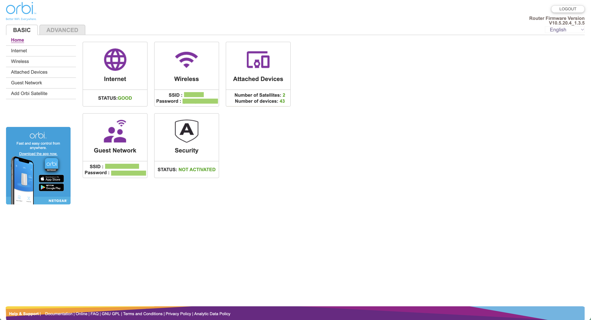
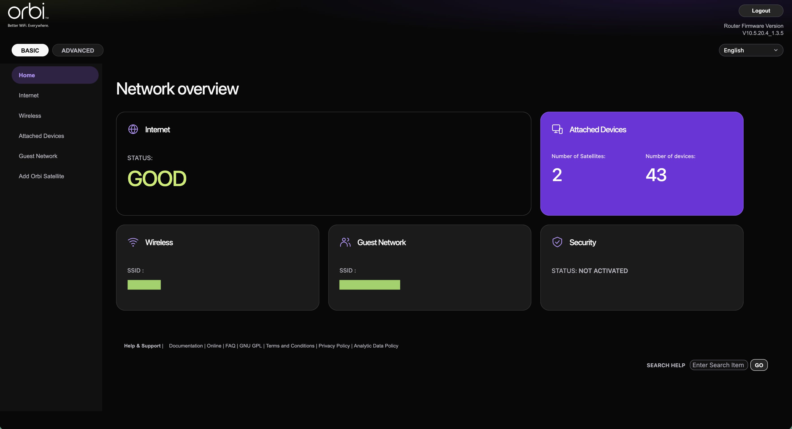
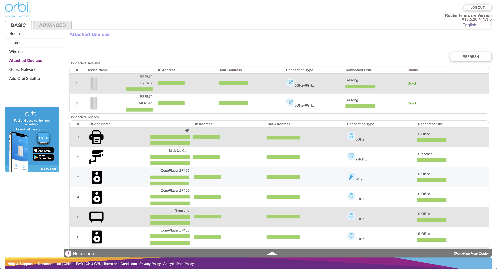
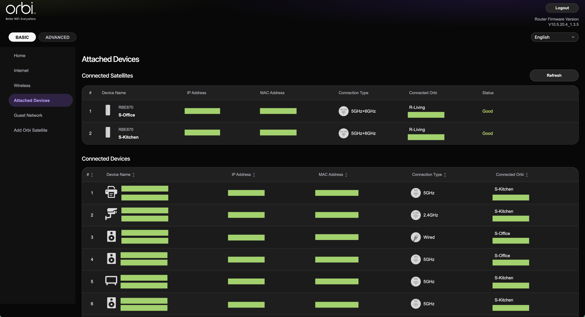

  

<h1 align="center">Better Orbi</h1>

  A Chrome extension that improves the look of your Orbi router's local admin site.

## Features

- Redesigned admin interface.
- Sortable attached devices table.
- Offline devices are shown in attached devices table
- Wider input fields where needed.

## Before and after samples

### Home

| Before | After |
| :---: | :---: |
|  |  |

### Attached devices

| Before | After |
| :---: | :---: |
|  |  |

## How to install

1. Clone this repository to your computer.
2. Open Chrome browser and enter `chrome://extensions` in the address bar.
3. Enable **Developer mode** in the top-right corner.
4. Click **Load unpacked** in the top-left corner.
5. Select the cloned `better-orbi` folder.
6. While connected to your Orbi Wi-Fi network, go to
   `orbilogin.local` or `orbilogin.com`. Reload the page if it is already open.

## Tested on

The extension has only been tested with the following Orbi setup:

| Router | Firmware |
| --- | --- |
| Orbi 870 (RBE871) | `V10.5.20.4_1.3.5` |

Other Orbi models and firmware versions may use different page layouts.
